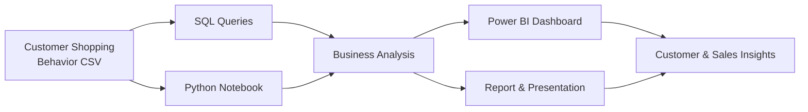

<div align="center">

# 🛍️ Ecommerce Customer Analysis

### Turning customer shopping data into actionable business insights

An end-to-end customer behavior analytics project that explores purchase patterns, category performance, subscription adoption, review ratings, shipping preferences and age-group trends using **Python**, **SQL** and **Power BI**.

<br />


<br />
<br />

<a href="https://github.com/Ayushb1234/Ecommerce_Customer_Analysis"><b>Repository</b></a>
&nbsp;&nbsp;·&nbsp;&nbsp;
<a href="#-dashboard-preview"><b>Dashboard</b></a>
&nbsp;&nbsp;·&nbsp;&nbsp;
<a href="#-key-insights"><b>Insights</b></a>
&nbsp;&nbsp;·&nbsp;&nbsp;
<a href="#-getting-started"><b>Getting Started</b></a>

</div>

<br />

---

## 📖 Table of Contents

1. [Project Overview](#-project-overview)
2. [Business Problem](#-business-problem)
3. [Dashboard Preview](#-dashboard-preview)
4. [Key Insights](#-key-insights)
5. [Business Recommendations](#-business-recommendations)
6. [Analysis Workflow](#-analysis-workflow)
7. [Tools & Technologies](#-tools--technologies)
8. [Project Structure](#-project-structure)
9. [Getting Started](#-getting-started)
10. [Business Questions Answered](#-business-questions-answered)
11. [Future Enhancements](#-future-enhancements)
12. [Author](#-author)

---

## 📌 Project Overview

This project analyzes a customer shopping behavior dataset to uncover who the customers are, what they buy, and how their purchasing differs across segments. The findings are delivered through an interactive Power BI dashboard, a written analysis report and a business presentation.

| Area | What the project examines |
| :--- | :--- |
| **Customer Behavior** | Customer count, subscription status, gender and age-group distribution |
| **Purchasing Trends** | Average purchase amount and sales by product category |
| **Product Performance** | Revenue and sales volume across Clothing, Accessories, Footwear and Outerwear |
| **Customer Feedback** | Average review rating across segments |
| **Fulfilment Preferences** | Shipping type and its effect on the dashboard metrics |
| **Business Communication** | Problem statement, analysis report and stakeholder presentation |

---

## 🎯 Business Problem

Retail teams collect large volumes of transaction data but often lack a clear view of how customer segments behave. This project addresses that gap.

**Objective:** make customer and sales patterns easy to explore, compare and communicate through a structured analytics workflow and an interactive dashboard.

**Goals:**

- Identify the product categories that drive the most revenue and sales volume
- Understand which age groups contribute most to revenue
- Measure subscription adoption and highlight the opportunity for growth
- Track customer satisfaction through average review ratings
- Enable stakeholders to filter results by gender, category, subscription and shipping type

The full problem statement is available in [`Business Problem Document.pdf`](Business%20Problem%20Document.pdf).

---

## 📊 Dashboard Preview

<div align="center">
  
  <br />
  <sub><i>Customer Behavior Dashboard built in Microsoft Power BI</i></sub>
</div>

<br />

### Key Performance Indicators

<div align="center">

<table>
  <tr>
    <td align="center" width="25%">
      <h2>675</h2>
      <b>Customers</b>
      <br />
      <sub>Total number of customers</sub>
    </td>
    <td align="center" width="25%">
      <h2>$60.41</h2>
      <b>Average Purchase</b>
      <br />
      <sub>Mean purchase amount</sub>
    </td>
    <td align="center" width="25%">
      <h2>3.72</h2>
      <b>Average Rating</b>
      <br />
      <sub>Mean review rating</sub>
    </td>
    <td align="center" width="25%">
      <h2>26.22%</h2>
      <b>Subscribers</b>
      <br />
      <sub>Customers with a subscription</sub>
    </td>
  </tr>
</table>

</div>

> **Note:** The values above reflect the dashboard view with the **Free Shipping** filter applied. They update dynamically as slicer selections change.

### Dashboard Components

| Visual | What it communicates |
| :--- | :--- |
| **KPI Cards** | Customer count, average purchase amount and average review rating |
| **Subscription Donut** | Share of customers with and without a subscription |
| **Revenue by Category** | Revenue comparison across the four product categories |
| **Sales by Category** | Sales volume comparison across the same categories |
| **Revenue by Age Group** | Revenue across Adult, Young Adult, Middle-aged and Senior customers |
| **Sales by Age Group** | Sales volume across the same age groups |
| **Slicers** | Interactive filters for subscription status, gender, category and shipping type |

---

## 💡 Key Insights

| # | Insight | Detail |
| :---: | :--- | :--- |
| 1 | **Clothing leads the business** | Clothing ranks first in both revenue and sales volume |
| 2 | **Accessories is the clear runner-up** | Accessories follows Clothing, ahead of Footwear and Outerwear |
| 3 | **Adults are the core segment** | The Adult group generates the highest revenue and sales among all age groups |
| 4 | **Seniors contribute the least** | The Senior group records the lowest revenue and sales |
| 5 | **Subscription adoption is low** | Only 26.22% of customers are subscribers, while 73.78% are not |
| 6 | **Satisfaction is moderate** | An average rating of 3.72 out of 5 indicates room to improve the customer experience |

<sub><i>Insights are drawn from the dashboard view described above and reflect descriptive patterns rather than statistical causation.</i></sub>

---

## 🚀 Business Recommendations

| Focus Area | Recommendation |
| :--- | :--- |
| **Subscription Growth** | With nearly three in four customers unsubscribed, introduce targeted incentives such as exclusive discounts or free shipping to convert repeat buyers |
| **Category Strategy** | Protect Clothing's lead through inventory depth and promotions, and cross-sell Accessories alongside Clothing purchases |
| **Underperforming Categories** | Review pricing, assortment and visibility for Footwear and Outerwear to lift their share |
| **Customer Targeting** | Prioritize Adult customers in marketing campaigns while testing tailored offers to engage the Senior segment |
| **Customer Experience** | Investigate the drivers behind the 3.72 average rating to identify product or service issues |

---

## 🧭 Analysis Workflow



| Stage | Description |
| :--- | :--- |
| **1. Data Collection** | Load the customer shopping behavior dataset from CSV |
| **2. Data Exploration** | Profile, clean and explore the data in a Jupyter notebook using Python |
| **3. SQL Analysis** | Answer targeted business questions with structured SQL queries |
| **4. Visualization** | Build an interactive Power BI dashboard with KPIs, charts and slicers |
| **5. Communication** | Summarize findings in a written report and a stakeholder presentation |

---

## 🧰 Tools & Technologies

<div align="center">


</div>

<br />

| Tool | Role in the project |
| :--- | :--- |
| **Python** | Data cleaning, transformation and exploratory analysis |
| **Jupyter Notebook** | Interactive environment for the analysis workflow |
| **SQL** | Business queries for segmentation and aggregation |
| **Microsoft Power BI** | Interactive dashboard design and visual exploration |
| **CSV** | Source dataset of customer shopping behavior |
| **PDF / PowerPoint** | Business problem, written report and presentation |

---

## 📁 Project Structure

```
Ecommerce_Customer_Analysis/
│
├── assets/
│   ├── customer_behavior_dashboard.png       # Dashboard screenshot
│   └── repository_files.png                  # Repository file overview
│
├── customer_shopping_behavior.csv            # Source dataset
├── customer_behaviour_analysis.ipynb         # Python analysis notebook
├── SQL_Queries.sql                           # SQL query script
├── SQL_queries.md                            # SQL documentation and notes
├── customer_behavior_dashboard.pbix          # Power BI dashboard
├── Business Problem Document.pdf             # Problem statement
├── Customer Shopping Behavior Analysis.pdf   # Written analysis report
├── Customer-Shopping-Behavior-Analysis.pptx  # Stakeholder presentation
└── README.md
```

| File | Purpose |
| :--- | :--- |
| `customer_shopping_behavior.csv` | Customer shopping behavior dataset |
| `customer_behaviour_analysis.ipynb` | Python notebook for data cleaning and exploratory analysis |
| `SQL_Queries.sql` | SQL script answering the core business questions |
| `SQL_queries.md` | Documentation explaining each SQL query |
| `customer_behavior_dashboard.pbix` | Interactive Power BI report |
| `Business Problem Document.pdf` | Business context and problem statement |
| `Customer Shopping Behavior Analysis.pdf` | Detailed written analysis |
| `Customer-Shopping-Behavior-Analysis.pptx` | Presentation of key findings |

---

## ⚙️ Getting Started

### Prerequisites

| Requirement | Purpose |
| :--- | :--- |
| Python 3.8+ | Run the analysis notebook |
| Jupyter Notebook or JupyterLab | Open the `.ipynb` file |
| Any SQL engine (MySQL, PostgreSQL or similar) | Execute the SQL queries |
| Microsoft Power BI Desktop | Open the `.pbix` dashboard |

### Step 1 — Clone the repository

```bash
git clone https://github.com/Ayushb1234/Ecommerce_Customer_Analysis.git
cd Ecommerce_Customer_Analysis
```

### Step 2 — Run the Python analysis

```bash
pip install jupyter
jupyter notebook customer_behaviour_analysis.ipynb
```

Install any additional libraries imported in the notebook's first cell before running all cells.

### Step 3 — Run the SQL queries

1. Import `customer_shopping_behavior.csv` into your SQL database
2. Open `SQL_Queries.sql` in your SQL editor
3. Refer to `SQL_queries.md` for an explanation of each query

### Step 4 — Explore the Power BI dashboard

1. Open `customer_behavior_dashboard.pbix` in Power BI Desktop
2. Use the slicers to filter by subscription status, gender, category and shipping type
3. Observe how KPIs and charts respond to each selection

### Step 5 — Review the business deliverables

Read the business problem document, the analysis report and the presentation to see how the findings are framed for stakeholders.

---

## ❓ Business Questions Answered

- How are customers distributed by subscription status?
- Which product categories generate the most revenue and sales?
- Which age groups contribute the most revenue and sales?
- What is the average purchase amount and review rating for each segment?
- How do the metrics change across gender, category, subscription and shipping type?

---

## 🔮 Future Enhancements

- [ ] Add a `requirements.txt` listing all Python dependencies
- [ ] Include a data dictionary describing each column in the dataset
- [ ] Document the SQL engine and version used
- [ ] Add Power BI data refresh and connection instructions
- [ ] Include an unfiltered dashboard screenshot as a baseline view
- [ ] Extend the analysis with customer segmentation using RFM or clustering
- [ ] Add predictive modeling for subscription conversion

---

## 👤 Author

<div align="center">

**Ayush Choudhary**

<a href="https://github.com/Ayushb1234">
  
</a>

</div>

---

<div align="center">

### ⭐ If you found this project useful, consider giving it a star

<i>Explore customer behavior. Understand purchasing patterns. Make better data-driven decisions.</i>

</div>
