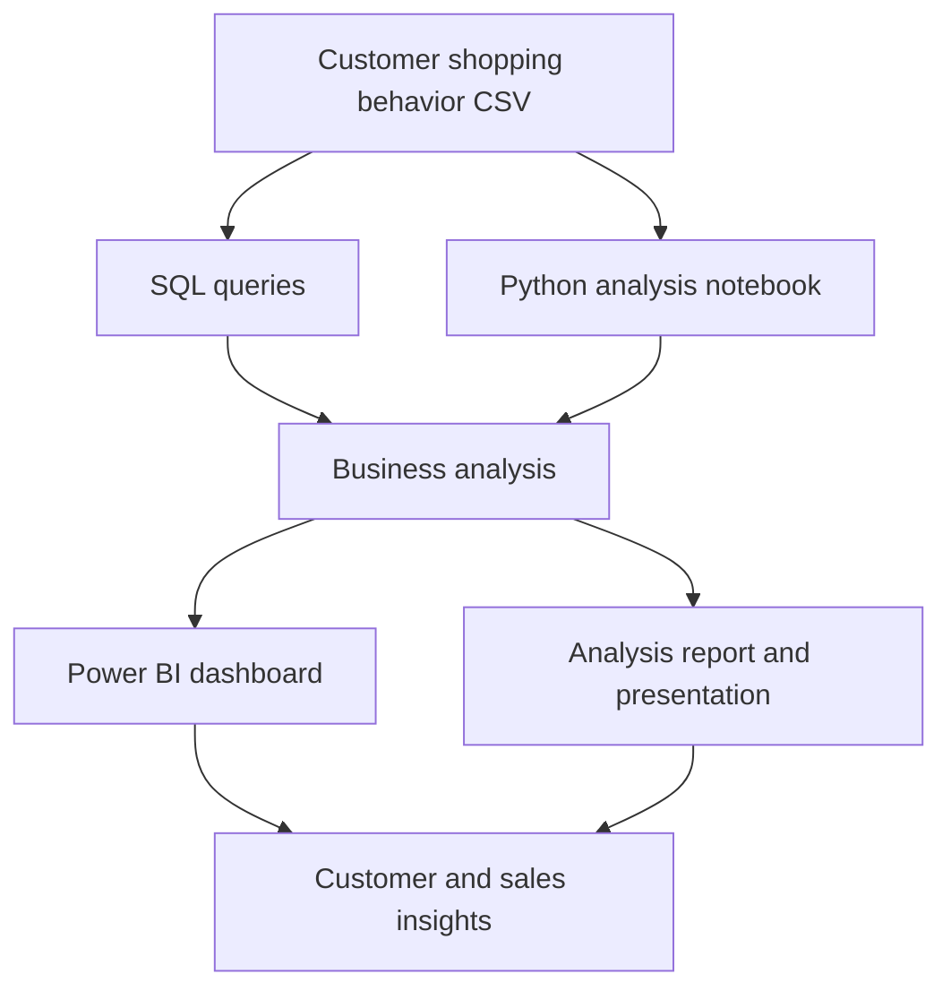

🛍️ Ecommerce Customer Analysis
Turning customer shopping data into actionable business insights
A customer behavior analytics project exploring purchase patterns, product-category performance, subscription behavior, customer ratings, shipping preferences, and age-group trends through Python, SQL, and Power BI.

  
  
  
  
  

  <a href="https://github.com/Ayushb1234/Ecommerce_Customer_Analysis">Repository</a>
  &nbsp;·&nbsp;
  <a href="#-dashboard-preview">Dashboard</a>
  &nbsp;·&nbsp;
  <a href="#-project-files">Project Files</a>
  &nbsp;·&nbsp;
  <a href="#-how-to-explore-the-project">How to Explore</a>

📌 Project at a Glance
Area	What this project examines
Customer behavior	Customer count, subscription status, gender, and age-group patterns
Purchasing trends	Average purchase amount and product-category sales
Product performance	Revenue and sales across Clothing, Accessories, Footwear, and Outerwear
Customer feedback	Average review rating
Fulfilment preferences	Shipping-type filters and their relationship to the dashboard view
Business communication	Supporting problem document, analysis report, and presentation

Objective: make customer and sales patterns easier to explore, compare, and communicate through a structured analytics workflow and an interactive Power BI dashboard.
Reading the dashboard correctly: the supplied dashboard screenshot appears to have Free Shipping selected. The KPI values below therefore describe the captured report state and may change when slicers are changed; they should not automatically be treated as unfiltered dataset totals.

📊 Dashboard Preview

  
   
  Customer Behavior Dashboard · Power BI screenshot supplied with the project

Key metrics visible in the supplied dashboard
<table>
  <tr>
    <td align="center" width="25%">
      <h2>675</h2>
      <b>Customers</b> 
      Number of Customers
    </td>
    <td align="center" width="25%">
      <h2>$60.41</h2>
      <b>Average Purchase</b> 
      Average Purchase Amount
    </td>
    <td align="center" width="25%">
      <h2>3.72</h2>
      <b>Average Rating</b> 
      Average Review Rating
    </td>
    <td align="center" width="25%">
      <h2>26.22%</h2>
      <b>Subscribers</b> 
      Subscription = Yes
    </td>
  </tr>
</table>The subscription chart also shows 73.78% of customers under No for subscription status in the captured view.
Dashboard components
Visual	What it communicates
KPI cards	Customer count, average purchase amount, and average review rating
Subscription donut	Share of customers with and without a subscription
Revenue by category	Revenue comparison across four product categories
Sales by category	Sales-volume comparison across the same categories
Revenue by age group	Revenue comparison across Adult, Young Adult, Middle-aged, and Senior groups
Sales by age group	Sales-volume comparison across the age groups
Slicers	Subscription status, gender, category, and shipping type

<b>🔎 Dashboard observations visible in the screenshot</b>
- Clothing is the leading category in both the revenue and sales charts shown.
- Accessories follows Clothing, with Footwear and Outerwear appearing after it.
- The Adult group has the highest displayed revenue and sales among the age groups; Senior is the lowest in the captured charts.
- The subscription donut shows a larger No segment than Yes.
- The report includes slicers for subscription status, gender, category, and shipping type, allowing the displayed visuals to be filtered.
These are visual observations from the screenshot, not claims about statistical significance or causation.

🧭 Analysis Workflow
The repository brings together a source dataset, SQL queries, a Python notebook, a Power BI report, and supporting documentation.

The diagram represents the high-level relationship between the repository artifacts. Exact transformations, SQL dialect, and notebook execution order should be confirmed from the source files.

🧰 Tools & Technologies

  
  
  
  
  
  

Tool / format	Role in this repository
Python	Programmatic analysis artifact in the Jupyter notebook
Jupyter Notebook	Interactive notebook file for the analysis workflow
SQL	Query script and accompanying Markdown notes
Microsoft Power BI	Dashboard/report authoring and interactive visual exploration
CSV	Customer shopping behavior dataset supplied with the project
PDF / PowerPoint	Business context, written analysis, and presentation artifacts

The README intentionally does not list specific Python packages or a database engine because those details were not available for verification from the supplied project archive.
📁 Project Files
The following files are visible in the GitHub repository screenshot supplied with the project.
File	Purpose / contents
Business Problem Document.pdf	Business problem and project context document.
Customer Shopping Behavior Analysis.pdf	PDF artifact for the customer shopping behavior analysis.
Customer-Shopping-Behavior-Analysis.pptx	Presentation version of the analysis.
SQL_Queries.sql	SQL query script.
SQL_queries.md	Markdown notes/documentation accompanying the SQL queries.
customer_behavior_dashboard.pbix	Power BI report file containing the dashboard.
customer_behaviour_analysis.ipynb	Jupyter notebook for the Python analysis.
customer_shopping_behavior.csv	Customer shopping behavior dataset.

<b>🗂 Repository file-list screenshot</b>

  

🚀 How to Explore the Project
1. Clone the repository
git clone https://github.com/Ayushb1234/Ecommerce_Customer_Analysis.git
cd Ecommerce_Customer_Analysis
2. Explore the dataset and notebook
Open customer_shopping_behavior.csv to inspect the supplied data, then open customer_behaviour_analysis.ipynb in Jupyter Notebook or JupyterLab.
python -m pip install jupyter
jupyter notebook customer_behaviour_analysis.ipynb
The screenshot does not expose a requirements.txt file or the notebook's import list. Install any additional Python packages required by the notebook cells before running the full analysis.

3. Review the SQL work
Open SQL_Queries.sql in your SQL editor and refer to SQL_queries.md for the accompanying notes. Use a database engine compatible with the SQL syntax in the script.
4. Open the Power BI dashboard
Open customer_behavior_dashboard.pbix using Microsoft Power BI Desktop. Use the slicers to explore how the dashboard visuals respond to subscription status, gender, category, and shipping type selections.
5. Read the business deliverables
Review the business problem document, analysis PDF, and PowerPoint to understand how the work is framed and communicated.
💡 Business Questions This Dashboard Helps Explore
- How are customers distributed by subscription status?
- How do revenue and sales compare across product categories?
- Which age groups contribute the most revenue and sales in the selected report view?
- What is the average purchase amount and average review rating in the current filter context?
- How do the visible metrics change when gender, category, subscription, or shipping filters are applied?
🧪 Reproducibility Notes
To make the project easier for another analyst to reproduce, consider adding these items to the repository:
- requirements.txt with the Python packages imported by the notebook.
- A short data dictionary describing the CSV columns and their meanings.
- The database engine/version and setup instructions used for the SQL script.
- A note explaining whether the Power BI report expects a local CSV path or a database connection, plus refresh instructions.
- A screenshot of the dashboard with all slicers cleared, so readers can distinguish the default view from filtered views.
👤 Author
Ayush Choudhary
GitHub: @Ayushb1234

⭐ If this project was useful, consider giving the repository a star!
Explore customer behavior. Understand purchasing patterns. Make better data-driven decisions.

